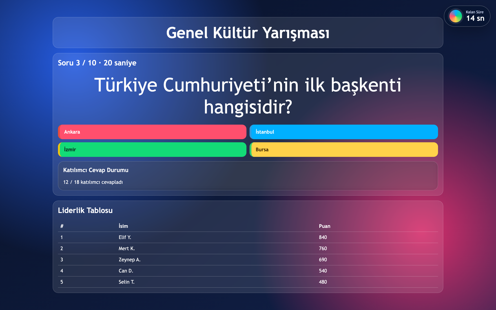
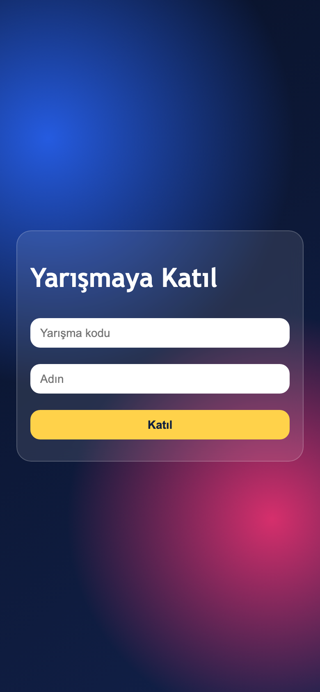

# 🎓 Bilgi Yarışması

> A Kahoot-style classroom quiz app for local networks: create quizzes, import questions from Excel, run live sessions and project the scoreboard.

[](https://www.electronjs.org/)
[](https://www.sqlite.org/)
[](LICENSE)

<p align="center">
  <a href="https://www.buymeacoffee.com/cmtrkr"></a>
</p>

Bilgi Yarışması is a desktop quiz host for teachers. The Electron app opens an admin window and a presentation window, serves participant pages over the local network, and keeps quizzes, questions, sessions, participants and answers in SQLite. Students join with a short code on their phones — no accounts, no cloud, no internet dependency.

## 📸 Screenshots

<p align="center">
  
  <br>
  <sub>Presentation screen — question, countdown, answer status and live leaderboard.</sub>
</p>

<p align="center">
  
  <br>
  <sub>Participant join screen on a phone.</sub>
</p>

> The screenshots show the app's real pages with sample quiz data. They are not captures of a specific live classroom.

## ✨ Features

- 🛠️ **Quiz editor** — create quizzes, add open-ended or multiple-choice questions, set duration and points, publish when ready.
- 📥 **Excel import** — bulk-import questions from `.xlsx`/`.xls`, plus a downloadable template.
- 🔢 **Join code** — students enter a random session code and wait for admin approval.
- ✅ **Participant approval** — the admin admits participants before questions are visible.
- 📺 **Presentation window** — full-screen question/standby view and a live scoreboard for the projector.
- 📱 **Phone-friendly participant screen** — join, wait, answer and see results.
- 💾 **SQLite storage** — quizzes, questions, sessions, participants and answers stay on the teacher's computer.
- 🌐 **LAN only** — the Express + WebSocket server runs locally; no external service is required.

## 🚀 Run

```bash
npm install
npm start
```

The app opens:

- **Admin window** — create quizzes, approve participants, control the session.
- **Presentation window** — project this screen.
- A LAN address is shown in the admin window; students open it on their phones.

### Build a distributable

Use `electron-builder` or `electron-forge` if you need an installer. The repository ships the development setup only.

## 🏗️ How it works

```text
Electron main process
├── BrowserWindow: admin UI
├── BrowserWindow: presentation UI
├── Express server on :4780
│   ├── static pages: admin, participant, presentation
│   ├── REST/API for quizzes and sessions
│   └── WebSocket for live state
└── SQLite database (quiz.db)
```

The admin publishes a session, students join over the LAN, and WebSocket messages keep every screen in sync.

## 📁 Project structure

```text
├── main.js                       # Electron entry + Express/WebSocket server
├── quiz.db                       # SQLite database
├── public/
│   ├── admin.html                # Admin shell
│   ├── admin-quiz-editor.html    # Quiz and question editor
│   ├── admin-session.html        # Live session control
│   ├── participant.html          # Student join/answer screen
│   ├── presentation.html         # Projector screen
│   ├── styles.css
│   └── *.js
└── scripts/seed-mock-questions.js
```

## ⚠️ Notes

- The UI is in Turkish.
- Allow Node/Electron through the local firewall so phones can reach port `4780`.
- The app is designed for a trusted classroom LAN. Do not expose it to the public internet without a reverse proxy and authentication.
- Back up `quiz.db` before upgrading or moving the app.

## ❤️ Support

If this quiz app is useful in your classroom, you can buy me a coffee:

<p align="center">
  <a href="https://www.buymeacoffee.com/cmtrkr"></a>
</p>

## 📄 License

[MIT](LICENSE) © 2026 Cem Türker.
